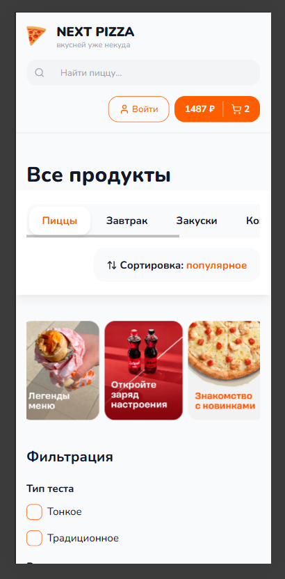

<h1 align="center">Виктор — Frontend-разработчик/fullstack-разработчик</h1>

  React · Next.js · TypeScript · Zustand · Tailwind · Prisma / PostgreSQL · Docker

  <a href="https://t.me/IA_educada">Telegram</a> ·
  <a href="mailto:strokof2@gmail.com">Email</a> ·
  <a href="https://github.com/victorStrokov">GitHub</a>

---

## Обо мне

Frontend-разработчик. Делаю не только интерфейсы, но и полный цикл:
состояние, API, база данных, деплой.

- Каталоги с фасетными фильтрами, админ-панели, личные кабинеты, корзина и оплата
- Next.js App Router: серверные и клиентские компоненты, server actions
- Админки на 20+ разделов: роли и права доступа, таблицы, фильтры, загрузка медиа
- REST API: состояния загрузки и ошибок, кеширование через TanStack Query
- Backend: Prisma + PostgreSQL, API routes, авторизация и роли
- Docker, nginx, CI/CD на GitHub Actions, домены и HTTPS
- Открыт к предложениям по фронтенд- и фулстек-разработке

---

## Проекты

### Платформа торгового каталога

`Next.js 16 · React 19 · TypeScript · Prisma · PostgreSQL · Tailwind · Zustand · Docker`

Проект для заказчика. Каталог с фасетными фильтрами (цена, размеры, материалы, цвета),
админ-панель на 27 разделов, роли и права доступа, заявки с автоматическим распределением
по менеджерам и журналом событий, загрузка изображений в объектное хранилище
с оптимизацией, мониторинг ошибок и трейсинг.

Деплой настроен на двух платформах — Vercel и Amvera — на собственном домене проекта.

*Код закрыт — проект заказчика. Скриншоты по запросу.*

---

### 🍕 [NextPizza](https://nextpizza-nine.vercel.app) · [код](https://github.com/victorStrokov/nextpizza)

`Next.js 14 · React 18 · TypeScript · Prisma · NextAuth · Zustand · React Hook Form + Zod · Tailwind`

Интернет-магазин пиццы: каталог с фильтрацией, сортировкой и поиском, корзина,
оформление заказа, авторизация и личный кабинет, загрузка изображений,
формы с валидацией на Zod, письма через Resend.

**[Открыть демо →](https://nextpizza-nine.vercel.app)**

---

### ⚛️ [Pizza](https://github.com/victorStrokov/pizza2) — учебный проект

`React · TypeScript · Redux Toolkit · React Router · SCSS`

Стор на Redux Toolkit: слайсы корзины, фильтров и товаров, `createAsyncThunk`
для запросов к API, селекторы, типизированные `RootState` и `AppDispatch`,
сохранение корзины в localStorage. Поиск с дебаунсом, пагинация, сортировка,
скелетоны загрузки.

### Другие проекты

- **[crypto-TS](https://github.com/victorStrokov/crypto-TS)** — TypeScript-приложение для отображения криптовалют: фильтрация, UI-компоненты
- **[Sneakers](https://github.com/victorStrokov/Sneakers)** — React-каталог товаров с корзиной и адаптивным интерфейсом
- **[react-graphql](https://github.com/victorStrokov/react-graphql)** — React + Apollo Client, запросы и кеширование GraphQL

---

## Стек

**Frontend** — React, Next.js (App Router), TypeScript, Zustand, Redux Toolkit, React Router, React Hook Form, Zod  
**Стили и UI** — Tailwind CSS, SCSS, Radix UI, shadcn/ui  
**Данные** — REST API, TanStack Query, Prisma, PostgreSQL, MongoDB, GraphQL  
**Инфраструктура** — Docker, nginx, GitHub Actions, Vercel, Amvera, Sentry, Cloudflare R2  
**Backend** — Node.js, Next.js API routes, server actions

---

## 📫 Контакты

- 📧 Email: [strokof2@gmail.com](mailto:strokof2@gmail.com)
- 💬 Telegram: [@IA_educada](https://t.me/IA_educada)
- 🌐 GitHub: [victorStrokov](https://github.com/victorStrokov)

 Открыт к предложениям по фронтенд- и фулстек-разработке — пишите в Telegram.

